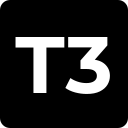

  

<h1 align="center">T3 Code for Umbrel</h1>

  Use Codex and Claude Code through T3 Code on your Umbrel server. Projects and credentials stay in persistent storage, and T3 Connect provides optional remote access.

  
  
  
  

> [!IMPORTANT]
> This is an independent Umbrel community app store, not an official T3 Tools or Umbrel release. You'll need your own provider account. Any subscription or usage charges are separate.

## Features

- Use Codex or Claude Code in T3 Code's browser interface after enabling the provider in settings.
- Install on an AMD64 or ARM64 Umbrel machine. The backend does not publish a port directly on the host.
- Keep projects, conversation history, settings, and provider credentials across container recreation and app updates.
- Link T3 Connect if you want to access the server remotely from supported clients.
- Get container releases built and smoke-tested for both architectures. GitHub Actions also checks for new stable T3 Code releases.

## Requirements

| Requirement | Details |
| --- | --- |
| Host | Running Umbrel installation with support for community app stores |
| CPU | AMD64 (x86-64) or ARM64 |
| Provider | Your own Codex/ChatGPT or Claude account, according to the provider's access requirements |
| Network | Internet access for downloading the app and authenticating providers |
| Optional | A T3 account to set up T3 Connect remote access |

## Quick start

1. In Umbrel, open **App Store → Community App Stores**.
2. Add this store: `https://github.com/syntaxbube/t3-code-docker-container`.
3. Install **T3 Code** and open it from the Umbrel dashboard.
4. Enter the app password from Umbrel's app details and select **Connect to T3 Code**.
5. Go to **Settings → Providers**, enable Codex or Claude Code, and sign in.

For Codex, select **Connect with ChatGPT**. For Claude Code, use the provider's sign-in flow. If needed, run `claude auth login` in the integrated terminal, follow the browser link, and paste the returned code into the terminal.

Create projects under `/home/node/projects`, or clone repositories there using the integrated terminal. Node.js 24, npm, Git, SSH, Bash, ripgrep, Python, make, and a C++ compiler are included. Other language toolchains are not bundled.

At `/umbrel`, previously paired browsers can select **Open T3 Code**. New pairing links expire after five minutes. To pair another browser, enter the app password again.

## Remote access with T3 Connect

To use T3 Connect:

1. On the `/umbrel` page, select **Set up T3 Connect remote access**.
2. When prompted, enter **umbrel** as the username and your Umbrel app password.
3. Select **Link / sign in**, open the HTTPS sign-in link shown on the page, and approve the device code on your device.
4. Once the T3 server has restarted, use **Status** to check authentication and reachability. Sign in with the same T3 account in the official desktop/mobile client or at [app.t3.codes](https://app.t3.codes).

Linking or selecting **Disconnect** restarts the T3 server and interrupts running tasks, so make these changes when it is idle. Disconnect disables remote access but keeps the CLI authorization. The Cloudflare tunnel client is pinned to a specific version and its checksum is verified. It does not install a host service. Check external reachability with your T3 account after linking.

## Storage, backups, and updates

Umbrel mounts `${APP_DATA_DIR}/data/home` at `/home/node` in the container. This directory holds projects, conversation history (`.t3`), provider credentials, and Git/SSH configuration.

Stop the app before making a manual backup of `data/` so its database is copied consistently. Restore files with UID/GID `1000:1000`. These backups contain credentials and should be protected. Files stored outside the mounted home may be lost when the container is recreated. Back up your projects before uninstalling.

Use Umbrel to install app updates. Running `t3 update` or global npm updates inside the container is not supported as an update method. GitHub Actions checks upstream for a stable T3 Code release every six hours. When it finds one, it builds and smoke-tests images for AMD64 and ARM64 before publishing. Umbrel then makes the update available; running installations are not upgraded automatically.

Pinned tools: T3 Code **0.1.9**, Codex **0.167.0**, Claude Code **2.1.319**.

Codex and Claude Code remain pinned independently of automatic T3 Code updates. The [development guide](docs/development.md) explains how releases are built and published.

## Troubleshooting

The [troubleshooting guide](docs/troubleshooting.md) covers expired pairing links, provider sign-in, T3 Connect, persistent storage, and logs.

## Development and contributing

See [Development and releases](docs/development.md) for architecture, CI, tests, and release instructions. Report packaging bugs in the [issue tracker](https://github.com/syntaxbube/t3-code-docker-container/issues).

## Credits and license

[T3 Code](https://github.com/pingdotgg/t3code) is developed by T3 Tools Inc. T3 Code and this packaging are MIT licensed. Bundled third-party tools have their own licenses and account requirements. See [LICENSE](LICENSE).
